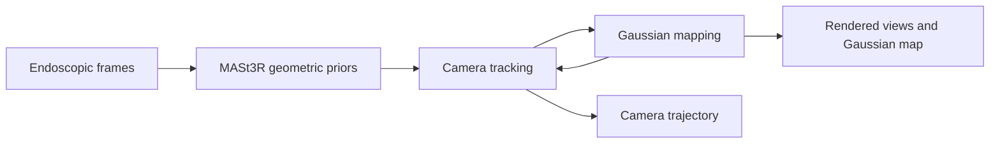

# Deform-GS

Gaussian splatting SLAM for endoscopic sequences, built on S3PO-GS. The baseline estimates camera poses and reconstructs a Gaussian map. The `DeformS3PO` branch adds time-varying Gaussians for deforming scenes.

[Trajectory demo](#trajectory-demo) · [How it works](#method) · [Run locally](#quick-start) · [Evaluation](#evaluation) · [License](#license)

## Trajectory demo


This plot comes from one historical baseline run on the StereoMIS easy sequence. The colored curve shows the estimated camera path and the dashed gray curve shows the reference. See the [original run artifact](https://github.com/Viiitoo/deform-gs/blob/85194a5e38d5af5d09b18af97dbcb9606ccc2341/results/stereo_seq_easy_stereo_seq_easy/2025-12-03-22-02-13/plot/evo_2dplot_final.png).

## Method



The front end uses MASt3R geometry to initialize poses and depth. Tracking refines camera poses against the rendered map, while mapping updates the Gaussian scene model using keyframes. The baseline also includes experimental confidence-weighted depth handling and robust depth fusion.

| Branch | What it contains |
| --- | --- |
| `main` | Baseline tracking and mapping, trajectory export, and rendering evaluation. See the [baseline development notes](https://github.com/Viiitoo/deform-gs/blob/c26ce8bf8526d20436b4864bf84ebcfa36d414ec/readme.md). |
| [`DeformS3PO`](https://github.com/Viiitoo/deform-gs/tree/DeformS3PO) | Time-dependent deformation using Gaussian radial basis functions. The deformation can update Gaussian position, rotation, scale, and opacity. See the branch README for the formulation and visualization tools. |

## Quick start

The example uses the baseline on `main`. You need an NVIDIA GPU and a CUDA toolchain compatible with the PyTorch build in [`environment.yml`](environment.yml).

```bash
git clone https://github.com/Viiitoo/deform-gs.git
cd deform-gs
conda env create -f environment.yml
conda activate S3PO-GS
python -m pip install --no-build-isolation \
    ./submodules/diff-gaussian-rasterization ./submodules/simple-knn
```

1. Get the metric checkpoint from [MASt3R](https://github.com/naver/mast3r#checkpoints) and save it as `checkpoints/MASt3R_ViTLarge_BaseDecoder_512_catmlpdpt_metric.pth`.
2. Set `Dataset.dataset_path` in the [StereoMIS easy config](configs/mono/Stereo/Stereo_seq_easy/stereo.yaml) and verify the camera calibration. The [TUM-format loader](utils/dataset.py) expects `rgb.txt`, `depth.txt`, `mono_depth.txt`, and either `groundtruth.txt` or `pose.txt`, plus the files they reference.
3. Run from the repository root.

```bash
python slam.py --config configs/mono/Stereo/Stereo_seq_easy/stereo.yaml
```

The example configuration writes results to a timestamped directory under `results/`.

## Evaluation

The baseline can save trajectories and evaluate rendered views. Output is controlled by the [sequence configuration](configs/mono/Stereo/Stereo_seq_easy/base_config.yaml) through settings such as `save_trj` and `eval_rendering`. The demo is a single-run illustration. For comparisons, record the commit, sequence and frame range, resolved configuration, and trajectory alignment settings.

| Path | Role |
| --- | --- |
| [`slam.py`](slam.py) | SLAM entry point and run configuration |
| [`utils/`](utils/) | Tracking, mapping, dataset loading, and evaluation |
| [`gaussian_splatting/`](gaussian_splatting/) | Gaussian representation and rendering |
| [`configs/mono/`](configs/mono/) | Dataset and sequence configurations |

## License

See the repository [MIT License](LICENSE). Third-party code, checkpoints, and datasets are subject to their respective terms.

## Acknowledgements

The project builds on S3PO-GS and uses [MASt3R](https://github.com/naver/mast3r) for geometric priors. The `DeformS3PO` branch draws on EH-SurGS for time-varying deformation.
