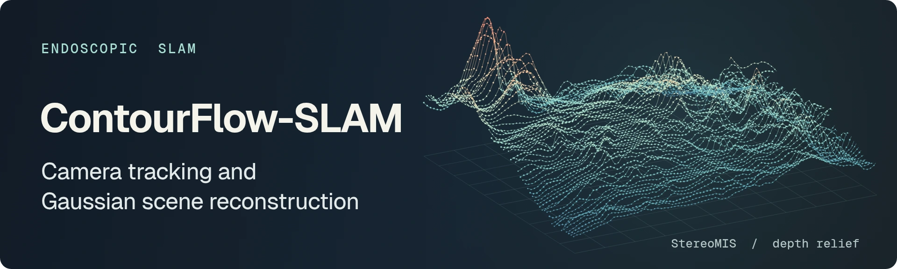
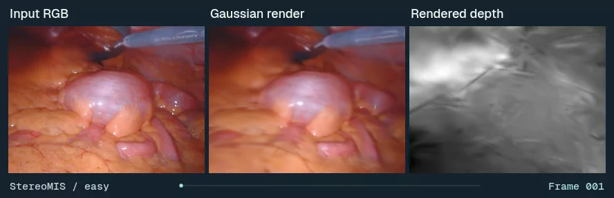
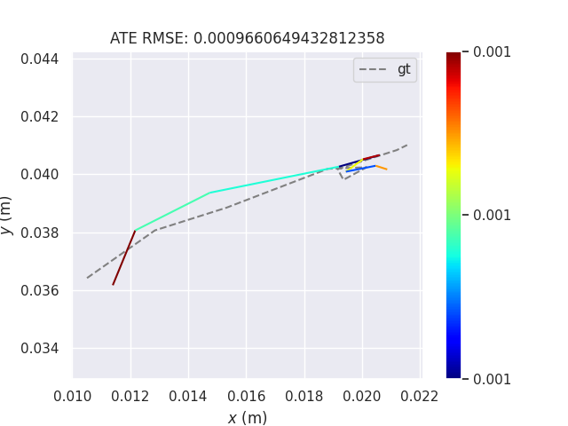

<h1 align="center">
  <picture>
    <source media="(max-width: 600px)" srcset="docs/assets/contourflow-slam-mobile.webp">
    
  </picture>
</h1>

<p align="center">
  <a href="#reconstruction-demo"><b>Watch the reconstruction</b></a> &nbsp;·&nbsp;
  <a href="#method">Method</a> &nbsp;·&nbsp;
  <a href="#evaluation">Evaluation</a> &nbsp;·&nbsp;
  <a href="#quick-start">Run locally</a>
</p>

**ContourFlow-SLAM** — Gaussian SLAM for deformable endoscopic scenes with contour-guided camera tracking and optical flow supervision.

The S3PO-GS baseline on `main` tracks the endoscope and builds the Gaussian map shown below. The [contour and flow experiments][contour-flow] use 3D contours to guide camera pose estimation and optical flow between keyframes to supervise the deforming map.

## Reconstruction demo

<picture>
  <source media="(prefers-reduced-motion: reduce)" srcset="docs/assets/stereomis-still.webp">
  
</picture>

Follow the instrument tip across the three panels. The center rendering captures its motion through the image, while fine tissue texture appears softer than in the input. The depth panel uses a separate grayscale range for each frame.

The loop samples 40 saved views from one baseline run. The cover plots the normalized depth from frame 100 as a relief. [Still comparison](docs/assets/stereomis-still.webp) · [Original frame 100][frame] · [Run configuration][config]

## Method

| Stage | How the map is built |
| --- | --- |
| **Initialize geometry** | MASt3R predicts depth and matches image features across views to initialize the relative camera pose. [Pose initialization](utils/init_pose.py) |
| **Track the camera** | The front end refines each pose against a rendering of the current map and selects keyframes for mapping. [Tracking loop](utils/slam_frontend.py) |
| **Update the map** | The back end optimizes the Gaussians over a window of keyframes. Tracking then uses the updated map for subsequent views. [Mapping loop](utils/slam_backend.py) |

**Baseline** · The default branch includes trajectory export, rendering evaluation, and experiments with confidence-weighted depth and robust depth fusion. [Baseline development notes][notes]

**Time-varying deformation** · On `DeformS3PO`, Gaussian radial basis functions model how each point’s position, rotation, scale, and opacity change over time. [Deformation branch and formulation][deform]

## Evaluation

The demo run evaluates the Gaussian map on non-keyframes from `stereo_seq_easy`. Color refinement increased mean PSNR from **24.06 to 28.22 dB** on these views.

| Rendering stage | PSNR ↑ (dB) | SSIM ↑ | LPIPS ↓ |
| --- | ---: | ---: | ---: |
| [Before color refinement][before] | 24.06 | 0.763 | 0.629 |
| [After color refinement][after] | **28.22** | **0.803** | **0.463** |

### Trajectory demo

The estimated camera path had an absolute trajectory error (ATE RMSE) of **0.97 mm** on the nine saved keyframes, after monocular similarity alignment to the reference poses. [Keyframe poses][poses] · [Trajectory statistics][stats]

<details>
<summary>View the estimated and reference paths in the XY plane</summary>



The color scale shows the translation error at each estimated pose. [Original trajectory plot][plot]

</details>

## Quick start

The baseline environment targets Python 3.11, PyTorch 2.1 and CUDA 11.8. Use an NVIDIA GPU and a compatible CUDA toolchain to build the rasterizer and KNN extensions. [Environment specification](environment.yml)

```bash
git clone https://github.com/Viiitoo/contourflow-slam.git
cd contourflow-slam
conda env create -f environment.yml
conda activate S3PO-GS
python -m pip install --no-build-isolation \
    ./submodules/diff-gaussian-rasterization ./submodules/simple-knn
```

1. **Install the checkpoint.** Save the metric weights to `checkpoints/MASt3R_ViTLarge_BaseDecoder_512_catmlpdpt_metric.pth`. [MASt3R checkpoints][mast3r]
2. **Point the loader at your sequence.** Set `Dataset.dataset_path` and verify the camera intrinsics in the sequence YAML. The TUM-format loader reads `rgb.txt`, `depth.txt`, `mono_depth.txt`, and either `groundtruth.txt` or `pose.txt`, together with the files they reference. [StereoMIS easy configuration](configs/mono/Stereo/Stereo_seq_easy/stereo.yaml) · [Dataset loader](utils/dataset.py)
3. **Run from the repository root.**

```bash
python slam.py --config configs/mono/Stereo/Stereo_seq_easy/stereo.yaml
```

The example writes a timestamped run under `results/`. Look in `viz/` for frame comparisons, `plot/` for trajectory evaluation, and `psnr/` for rendering metrics. The sequence settings control which outputs are saved. [Output settings](configs/mono/Stereo/Stereo_seq_easy/base_config.yaml)

## License

The repository uses the MIT License. Third-party code, checkpoints and datasets retain their own terms. [License](LICENSE)

The baseline builds on S3PO-GS and MASt3R. The time-varying branch draws on EH-SurGS. [S3PO-GS](https://github.com/3DAgentWorld/S3PO-GS) · [MASt3R](https://github.com/naver/mast3r) · [EH-SurGS](https://github.com/IRMVLab/EH-SurGS)

[notes]: https://github.com/Viiitoo/contourflow-slam/blob/c26ce8bf8526d20436b4864bf84ebcfa36d414ec/readme.md
[contour-flow]: https://github.com/Viiitoo/contourflow-slam/blob/contour-extraction/docs/version_stereo_full.md
[deform]: https://github.com/Viiitoo/contourflow-slam/tree/DeformS3PO
[mast3r]: https://github.com/naver/mast3r#checkpoints
[config]: https://github.com/Viiitoo/contourflow-slam/blob/85194a5e38d5af5d09b18af97dbcb9606ccc2341/results/stereo_seq_easy_stereo_seq_easy/2025-12-03-22-02-13/config.yml
[frame]: https://github.com/Viiitoo/contourflow-slam/blob/85194a5e38d5af5d09b18af97dbcb9606ccc2341/results/stereo_seq_easy_stereo_seq_easy/2025-12-03-22-02-13/viz/100.png
[before]: https://github.com/Viiitoo/contourflow-slam/blob/85194a5e38d5af5d09b18af97dbcb9606ccc2341/results/stereo_seq_easy_stereo_seq_easy/2025-12-03-22-02-13/psnr/before_opt/final_result.json
[after]: https://github.com/Viiitoo/contourflow-slam/blob/85194a5e38d5af5d09b18af97dbcb9606ccc2341/results/stereo_seq_easy_stereo_seq_easy/2025-12-03-22-02-13/psnr/after_opt/final_result.json
[poses]: https://github.com/Viiitoo/contourflow-slam/blob/85194a5e38d5af5d09b18af97dbcb9606ccc2341/results/stereo_seq_easy_stereo_seq_easy/2025-12-03-22-02-13/plot/trj_final.json
[stats]: https://github.com/Viiitoo/contourflow-slam/blob/85194a5e38d5af5d09b18af97dbcb9606ccc2341/results/stereo_seq_easy_stereo_seq_easy/2025-12-03-22-02-13/plot/stats_final.json
[plot]: https://github.com/Viiitoo/contourflow-slam/blob/85194a5e38d5af5d09b18af97dbcb9606ccc2341/results/stereo_seq_easy_stereo_seq_easy/2025-12-03-22-02-13/plot/evo_2dplot_final.png
